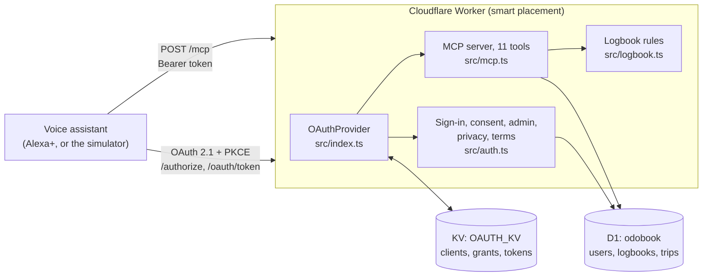

# Odobook

A voice car logbook. Odobook keeps the **ATO 12-week logbook** (Australia, km) or an **IRS mileage log** (US, miles) while you drive. It's an MCP server built to the published **Alexa+ MCP add-on** requirements, made for the Amazon "Build, Ship, Shape" hackathon (Alexa+ track).

- Live server: https://odobook-alexa.odobook-alexa.workers.dev
- MCP endpoint: `https://odobook-alexa.odobook-alexa.workers.dev/mcp`

## Try it

> "Start a work trip to Geelong."
> "End trip, odometer 52,394. It was a quote for a bathroom reno."
> "How's my logbook going?"

Odobook replies in one or two short spoken sentences, for example: *"Logged 84 km to Geelong for quote for a bathroom reno. Business use is 88% so far."*

## Contents

- [Alexa+ add-on requirements](#alexa-add-on-requirements)
- [Architecture](#architecture)
- [Tools](#tools)
- [Logbook rules](#logbook-rules)
- [Testing](#testing)
- [Deploy your own](#deploy-your-own)
- [Demo with the voice simulator](#demo-with-the-voice-simulator)
- [Agent Skill](#agent-skill)
- [Limitations and honest notes](#limitations-and-honest-notes)
- [More docs](#more-docs)

## Alexa+ add-on requirements

Amazon's Alexa+ add-on toolkit (the `alexa-ai` CLI) is open to select partners only, which Amazon staff confirmed on the hackathon Discord. So Odobook is built to the published requirements and demoed with a stand-in simulator (see [friction-log.md](friction-log.md)).

| Requirement | How Odobook meets it | Where |
|---|---|---|
| Streamable HTTP transport, MCP 2025-11-25 | Stateless Streamable HTTP: a fresh server and transport per POST, JSON responses, no sessions. Negotiates protocol `2025-11-25`. | `src/mcp.ts` (`mcpHandler`) |
| OAuth 2.1 authorization code + PKCE (S256) | `@cloudflare/workers-oauth-provider` handles `/authorize` and `/oauth/token`. Metadata advertises `S256` only, and `/authorize` refuses any request without an S256 `code_challenge`. Authorization codes are single use; replaying one is refused and revokes its tokens. | `src/index.ts`, `src/auth.ts` (`handleAuthorize`) |
| RFC 8707 resource indicators | Clients send `resource=<base>/mcp` on the authorization and token requests. | `src/index.ts` (`resourceMetadata`) |
| RFC 9728 protected resource metadata | Served at `/.well-known/oauth-protected-resource/mcp`, and the same document at the root form `/.well-known/oauth-protected-resource`. | `src/index.ts` |
| RFC 8414 authorization server metadata | Served at `/.well-known/oauth-authorization-server`. | `@cloudflare/workers-oauth-provider`, configured in `src/index.ts` |
| Pre-registered clients, no Dynamic Client Registration | No registration endpoint. Clients are created by an admin with `POST /admin/clients` (bearer `ADMIN_TOKEN`), as confidential (`client_secret_basic`) or public (`none`) clients. | `src/auth.ts` (`handleAdminClients`) |
| Unauthenticated requests get a bare 401, no `WWW-Authenticate` | The OAuth library adds `WWW-Authenticate`; a wrapper strips it from 401s on `/mcp`. Clients find the metadata at the well-known URLs. | `src/index.ts` (default `fetch`) |
| Round trips under 500 ms | Stateless JSON replies, few D1 queries per tool, smart placement next to the database. Measured live from Australia: about 65 to 360 ms per call. Locally: 8 to 25 ms. | `wrangler.jsonc` (`placement`), `scripts/e2e.mjs` (timing check) |
| `addon.json` manifest | Locales (en-US, en-AU), descriptions, example phrases, privacy and terms URLs, MCP endpoint, auth type and PRM URL. | `addon-package/addon.json` |
| Privacy policy and terms pages | `/privacy` and `/terms`. | `src/auth.ts` |
| Account linking UI | Sign in or create an account, then allow, on one page. Same-origin form posts only; strict CSP. | `src/auth.ts` (`authorizeForm`) |

## Architecture

One Cloudflare Worker is both the OAuth 2.1 authorization server and the protected MCP resource.



- **`src/index.ts`**: wires up `OAuthProvider`, serves PRM at both well-known paths, strips `WWW-Authenticate` from `/mcp` 401s.
- **`src/auth.ts`**: the `/authorize` page (sign-in or sign-up and consent), PBKDF2 password hashing, `POST /admin/clients`, landing, privacy and terms pages.
- **`src/mcp.ts`**: the 11 tools and the `/mcp` handler. Replies are written to be read aloud; details go in `structuredContent` for screens.
- **`src/logbook.ts`**: pure logbook rules (periods, vague purposes, late entries, totals, business %, CSV). No Workers or database code, so it's unit tested on its own.
- **`schema.sql`**: D1 tables `users`, `logbooks`, `trips`, `amendments`.
- **Storage**: D1 holds accounts and logbooks. KV holds OAuth clients, grants and tokens (managed by the library).
- **Smart placement**: a tool call makes several D1 queries, so the Worker runs near the database and each call costs one long-haul round trip, wherever the caller is.

## Tools

| Tool | What it does |
|---|---|
| `start_logbook` | Starts a logbook for a car (make, model, rego, odometer). AU runs 12 weeks; US runs to 31 December. Warns if an AU logbook crosses 30 June, and asks for engine size if missing. |
| `update_logbook` | Fixes car details (engine cc, rego, make, model). The starting odometer can only change before any trip is logged. |
| `discard_logbook` | Deletes the running logbook, only while it has no completed trips (for example, set up with the wrong car). |
| `start_trip` | Starts timing a trip now. Odometer defaults to the last known reading and can't go backwards. Purpose and destination are optional until the end. |
| `end_trip` | Ends the running trip from an odometer reading or a distance. Refuses a business trip with a vague or missing purpose. Replies with the business-use % so far. |
| `log_trip` | Records a past trip by date, from odometer readings or a distance. Marks it late if entered more than a day after the trip. |
| `cancel_trip` | Throws away the running trip. Completed trips are kept. |
| `logbook_status` | Days elapsed and left, trips, business and total distance, business-use %, any running trip, and the first warning. |
| `list_trips` | Recent completed trips, newest first (default 5, max 50). |
| `close_logbook` | Closes the period with a final odometer reading and freezes the business-use %. Warns if an AU logbook ran under 12 weeks. |
| `export_logbook` | Returns the logbook as CSV (date, times, odometer, distance, kind, purpose, destination, late flag) as an embedded resource. |

Every tool carries MCP annotations (`readOnlyHint`, `destructiveHint`, `idempotentHint`). The tool descriptions for `cancel_trip`, `discard_logbook` and `close_logbook` tell the assistant to confirm with the driver first. Scopes are enforced: a token without `logbook:write` can only call the read-only tools.

## Logbook rules

Odobook keeps records. It isn't tax advice and never works out a dollar deduction.

- **ATO logbook (AU, km)**: a period of 12 continuous weeks (84 days, start day included). Records make, model, rego and engine size, and for each journey the date, start and end odometer, distance and purpose. Warns when a first-year logbook would run past 30 June (it must fit inside one income year), and when a closed logbook ran under 12 weeks. Flags business trips without odometer readings.
- **IRS mileage log (US, miles)**: date, miles, destination and business purpose for each trip, kept to the end of the tax year (31 December).
- **Purpose specificity**: "business", "work", "work trip" and similar aren't a purpose. `end_trip` and `log_trip` refuse them for business trips and ask what the trip was for. A trip ended with neither a kind nor a purpose isn't guessed: Odobook asks whether it was work or private.
- **Late entries**: a past trip entered more than 24 hours after it happened is stored with `late = 1`, shown in status warnings and in the CSV.
- **Odometer chain**: `start_trip` defaults to the latest reading and refuses a lower one; `end_trip` refuses a reading below the trip's start; `close_logbook` refuses a reading below the last one; the starting odometer is locked once trips exist. A single trip over 3,000 units is queried as a likely misreading.
- **Business % from the odometer**: total distance is the latest odometer reading minus the start, because private driving often isn't logged trip by trip. If logged trips add up to more (trips entered by distance only), that sum is used instead. Business % = business distance / total distance, frozen when the logbook closes.

## Testing

| Suite | Command | Needs |
|---|---|---|
| Unit tests (10, logbook rules) | `npm test` | Node 22.6+ (uses `--experimental-strip-types`) |
| Typecheck | `npm run typecheck` | |
| End-to-end: OAuth, all 11 tools, latency | `BASE=<url> ADMIN_TOKEN=<token> npm run test:e2e` | A running server |
| Browser account linking (headless Chromium) | `BASE=<url> ADMIN_TOKEN=<token> npm run test:browser` | `npx playwright install chromium` once |

`ADMIN_TOKEN` comes from `.dev.vars` (not committed). For the live server use the deployed secret's value.

`scripts/e2e.mjs` walks the Alexa+ path: bare 401, PRM and AS metadata, a pre-registered confidential client, PKCE + `resource`, sign-up, token exchange, `initialize` on `2025-11-25`, every tool (including refusals for vague purposes and locked odometers), code replay, the simulator's public-client flow on a random loopback port, and a check that every round trip is under 500 ms. `scripts/browser-e2e.mjs` does sign-up, sign-in and a wrong password in a real browser and checks for console or CSP errors.

Both e2e scripts create a test client and a test account (`e2e-…@example.com`, `browser-…@example.com`) on the server they run against.

Local run:

```sh
npm install
printf 'PUBLIC_URL=http://localhost:8787\nADMIN_TOKEN=%s\n' "$(openssl rand -hex 24)" > .dev.vars
npm run db:local
npm run dev            # http://localhost:8787
BASE=http://localhost:8787 ADMIN_TOKEN=<from .dev.vars> npm run test:e2e
```

## Deploy your own

```sh
npm install
npx wrangler login
npx wrangler kv namespace create OAUTH_KV      # copy the id into wrangler.jsonc kv_namespaces
npx wrangler d1 create odobook                 # copy the database_id into wrangler.jsonc d1_databases
npm run db:remote                              # apply schema.sql to the remote D1
npx wrangler secret put ADMIN_TOKEN            # a long random string
npm run deploy
```

Set `PUBLIC_URL` in `wrangler.jsonc` to your Worker's URL (the MCP resource is `PUBLIC_URL + "/mcp"`) and deploy again if it changed.

Register a client (the voice assistant or simulator) ahead of time:

```sh
curl -X POST https://<your-worker>/admin/clients \
  -H "Authorization: Bearer $ADMIN_TOKEN" -H "Content-Type: application/json" \
  -d '{"name":"Voice simulator","redirectUris":["http://127.0.0.1/callback"],"public":true}'
```

It returns `clientId` (and `clientSecret` for confidential clients; omit `"public": true` for those). A loopback redirect without a port accepts any port, which suits desktop simulators.

## Demo with the voice simulator

The demo uses the community [mcp-voice-simulator](https://github.com/AlSayedGamal/mcp-voice-simulator) as an Alexa+ stand-in, with Claude as the brain.

1. Register a public client as above and note its `clientId`.
2. Point the simulator at `https://<your-worker>/mcp` with that client ID, and put `ANTHROPIC_API_KEY` in its `.env` (never committed).
3. Start the simulator, link the account in the browser window it opens (create an account or sign in), then talk to it.

A Bedrock-based brain for the simulator lives under [`simulator/`](simulator/README.md), with its own setup steps.

## Agent Skill

[`skills/odobook-car-logbook/SKILL.md`](skills/odobook-car-logbook/SKILL.md) is an Agent Skill that teaches an assistant how to drive the tools: which tool fits which phrase, asking for a specific purpose, one question at a time while driving, confirming destructive actions, and never estimating a deduction.

## Limitations and honest notes

- **Not tested against real Alexa+.** The Alexa+ add-on toolkit is partner-gated, so Odobook has only been run against the stand-in simulator and its own e2e tests.
- **`addon.json` is unvalidated.** It follows the field list in Amazon's docs but hasn't been through `alexa-ai` validation or deploy; the nesting may need changes. Its icon and carousel image URLs (`/assets/...`) aren't served yet.
- **Past-trip odometer readings aren't checked against the chain.** `log_trip` checks start against end, but not against other trips.
- **No voice editing of completed trips.** The `amendments` table exists for an audit trail but nothing writes to it yet.
- **One open logbook per account**, and one running trip at a time.
- **Hackathon prototype, not tax advice.** Check ato.gov.au or irs.gov, or ask a registered tax agent. Don't rely on Odobook as your only tax record yet.

## More docs

- [`docs/`](docs/): demo script, Devpost write-up and product feedback.
- [`friction-log.md`](friction-log.md): what went wrong with the Alexa+ tooling and what we did instead.
- [`simulator/README.md`](simulator/README.md): the Bedrock brain for the voice simulator.
- `scripts/seed-demo.mjs`: seeds a demo logbook.

## License

[MIT](LICENSE) © 2026 Jayden Tebble
